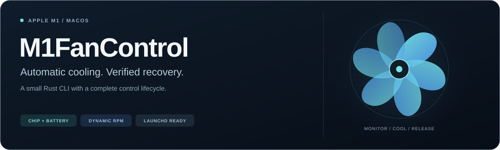
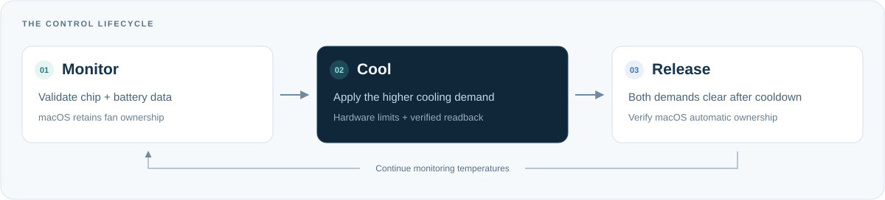
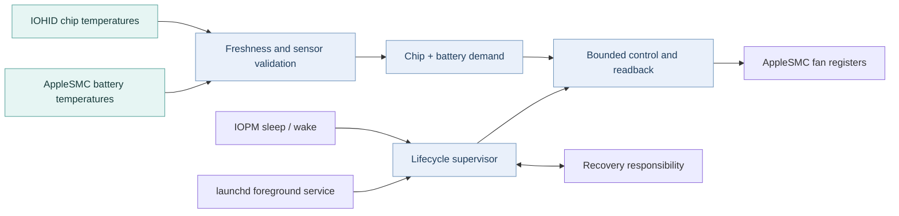

<p align="center">
  <strong>English</strong> · <a href="README.zh-CN.md">简体中文</a>
</p>

<p align="center">
  
</p>

<p align="center">
  <strong>A lightweight, local fan controller with automatic thermal management.</strong><br>
  Monitor chip and battery temperatures. Cool on demand. Return control to macOS.
</p>

<p align="center">
  
</p>

<p align="center">
  <a href="#installation">Get started</a> ·
  <a href="#cli-usage">CLI</a> ·
  <a href="#automatic-thermal-control">Thermal policy</a> ·
  <a href="deploy/README.md">System service</a> ·
  <a href="docs/ARCHITECTURE.md">Architecture</a> ·
  <a href="docs/PROVENANCE.md">Provenance</a>
</p>

---

M1FanControl connects directly to **AppleSMC through IOKit** and reads named chip temperature events through **IOHID**. Run it in your Terminal, start a background worker, or install the optional system LaunchDaemon. Temperature demand determines when the controller takes over; verified automatic restoration returns fan management to macOS.

Built for fan-equipped **Apple M1** Macs. No GUI, kernel extension or SIP changes required.

## Features

| Observe | Control | Recover |
| --- | --- | --- |
| Actual and target RPM, fan modes and hardware limits | Hardware-maximum mode or automatic chip + battery cooling | Verified automatic restoration on stop and ordinary failures |
| Live temperatures and read-only policy preview | Hysteresis, gradual speed reduction and bounded readback | Recovery journal, fresh sensor qualification and bounded retry |
| Opt-in per-operation SMC traces | Foreground, detached worker or native launchd service | Sleep notification handling and wake reconnection |

<p align="center">
  
</p>

## Installation

Install [Apple's Command Line Tools](https://developer.apple.com/xcode/resources/) and a current stable [Rust toolchain](https://rustup.rs/) with `rustfmt` and `clippy`. The project uses Rust edition 2024 and one Cargo dependency, `libc`, pinned by `Cargo.lock`.

```sh
git clone https://github.com/TanhJK728/M1FanControl.git
cd M1FanControl
cargo build --locked --release

# Start with read-only inspection
./target/release/m1fan status
./target/release/m1fan preview --samples 10
```

Run directly from `target/release`; no binary download is needed. Building does not install or start a controller. For the supported hardware scope and validation status, see [Compatibility](#supported-hardware--compatibility).

## CLI Usage

**Inspect without taking control**

```sh
./target/release/m1fan status
./target/release/m1fan monitor --samples 10
./target/release/m1fan preview --samples 10
./target/release/m1fan verify-auto
```

`monitor` shows live readings; `preview` also shows proposed cooling demand. Omit `--samples` to keep either command running until interrupted.

**Control in the foreground**

```sh
sudo ./target/release/m1fan max   # Hardware-reported maximum
sudo ./target/release/m1fan run   # Automatic thermal policy
```

Ctrl+C requests and verifies restoration to automatic mode.

**Run in the background**

```sh
sudo ./target/release/m1fan start
sudo ./target/release/m1fan daemon-status
sudo ./target/release/m1fan stop
```

The detached worker survives Terminal closure. Status includes uptime, temperatures, RPM, ownership, transitions, power events and errors. For explicit recovery when no controller owns the lock, use `sudo ./target/release/m1fan auto`.

<details>
<summary><strong>Detailed diagnostics</strong></summary>

Add `--trace /path/to/new-trace.jsonl` to a data/control command to record each SMC operation. The destination must be new. Normal operation does not produce full wire traces. Traces contain raw register traffic and runtime measurements; review them before sharing.

</details>

## Automatic Thermal Control

The controller tracks chip and battery cooling demands independently and applies the **higher requested speed**.

| Temperature source | Start cooling | Request maximum | Clear demand |
| --- | --- | --- | --- |
| Hottest validated chip sensor | **55°C** | **70°C** | Below 50°C continuously for 30 seconds |
| Hottest validated battery sensor | **35°C** | **40°C** | Below 35°C continuously for 30 seconds |

An active demand rises linearly from 25% to 100% of the hardware-reported RPM span:

```text
target = minimum + fraction × (maximum − minimum)
```

Both demands must clear before automatic management is restored. Monitoring continues after release. The same policy applies on AC and battery power.

Heating raises the target promptly. Lower requests require confirmation and use elapsed-time speed reduction with a small-change deadband. Invalid, incomplete, stale or repeatedly unavailable telemetry triggers recovery and fresh qualification.

These source-configurable thresholds are engineering defaults for early, audible cooling. They are not Apple temperature limits or a battery lifespan guarantee. Battery keys `TB1T` and `TB2T` follow Stats' mapping; exact physical locations remain unconfirmed. Charging and battery charge limits are outside this tool's scope.

## Background Service & Sleep/Wake Support

The optional system LaunchDaemon manages **`m1fan serve` directly in the foreground**, independent of your Terminal or checkout directory.

Build and test as an ordinary user, then install the reviewed binary:

```sh
cargo test --locked
binary_sha=$(shasum -a 256 target/release/m1fan | awk '{print $1}')
sudo ./deploy/install.sh "$PWD/target/release/m1fan" "$binary_sha"
sudo "/Library/Application Support/M1FanControl/enable.sh"
sudo "/Library/Application Support/M1FanControl/status.sh"
```

Installation starts **disabled**. Enabling registers boot startup and starts monitoring. The local SHA-256 binds installation to the binary you reviewed; it is not an external release signature.

| Action | Command |
| --- | --- |
| Disable startup, stop and verify automatic restoration | `sudo "/Library/Application Support/M1FanControl/disable.sh"` |
| Stop, restore and remove the managed installation | `sudo "/Library/Application Support/M1FanControl/uninstall.sh"` |

`m1fan stop` stops the current instance while retaining boot enablement. Use `disable.sh` for persistent disablement. Runtime logs rotate; private management history is retained after uninstall.

Sleep notifications gate control and request restoration before a bounded acknowledgement deadline. Wake and monitoring gaps over five seconds rebuild connections, confirm automatic ownership and require three fresh healthy samples. Recovery attempts use delays of **5 → 15 → 30 → 60 seconds**, then 60 seconds thereafter.

Ordinary errors and SIGINT/SIGTERM/SIGHUP attempt verified restoration. SIGKILL, power loss and kernel failure cannot execute cleanup. The journal retains pending recovery for a subsequent instance when runtime state survives; `/var/run` state is normally cleared across a reboot. See the [service guide](deploy/README.md) for management and upgrade details.

## Architecture



The transport allows only validated fan-control keys and reads hardware speed limits along the control path. An exclusive controller lock prevents concurrent M1FanControl writers. Separate checks distinguish write acknowledgement, mode/target readback, subsequent ownership loss and actual RPM response.

Explore the [full architecture](docs/ARCHITECTURE.md), [development history](docs/DEVELOPMENT_HISTORY.md) and [source provenance](docs/PROVENANCE.md).

## Supported Hardware / Compatibility

Control requires **Apple M1 on ARM64 macOS**, a physical fan, and the expected SMC/IOHID interfaces. Automatic control requires complete named chip sensor groups and both battery keys. Software discovery/control supports multiple fans; hardware validation covers a single-fan M1 MacBook Pro configuration.

| Validation scope | Status |
| --- | --- |
| Manual and temperature-triggered acceleration, background operation, stop/restoration, service management | Checked on development M1 hardware |
| Sleep events, wake reconnection, sensor faults and recovery state machines | Implemented and covered by Mock tests |
| Physical lid sleep/wake, startup before login, natural cooling through both release thresholds, deliberate crash/restart recovery | End-to-end hardware validation pending |

M1 Pro/Max/Ultra, newer chips, Intel Macs and fanless Macs are outside the supported control scope. Private Apple interfaces may change across macOS versions. Unsupported data is rejected rather than replaced with guessed keys or limits. Do not run another fan controller alongside M1FanControl.

## Development and Testing

```sh
cargo fmt --check
cargo clippy --locked -- -D warnings
cargo test --locked
cargo build --locked --release
```

The v0.5.0 source release passed **250 tests**, with one passive native power test ignored by default. See the [release audit](docs/RELEASE_AUDIT.md) for the recorded verification scope.

Default tests use synthetic hardware readings, deterministic clocks, temporary files and injected deployment commands. They do not take fan ownership, install services or exercise physical sleep. Deployment tests include shell/plist checks and require macOS tools. Hardware validation remains a separate explicit step.

## Prior Art & Acknowledgments

M1FanControl builds on the technical work of these projects:

- **[Ramin Sharifi's MacFanControl](https://github.com/raminsharifi/MacFanControl)** — adapted Rust AppleSMC transport, fan-control sequences and temperature-discovery patterns.
- **[Serhiy Mytrovtsiy's Stats](https://github.com/exelban/stats)** — control/release sequences, IOHID acquisition, sensor mappings and lifecycle prior art.
- **[Alexander Goodkind's macos-smc-fan](https://github.com/agoodkind/macos-smc-fan)** — research on Apple Silicon fan arbitration and system target overwrites.
- **Chromium and Apple interface sources** — sensor naming, ABI, event clocks and power notification semantics.

The [provenance audit](docs/PROVENANCE.md) records fixed revisions, adapted regions and independent contributions, including the earlier IOHID reader ancestry. Applicable copyrights and full license texts are retained in [third-party notices](THIRD_PARTY_NOTICES.md) and [`licenses/`](licenses/).

## Original Contributions

The project's independent engineering work includes:

- **Observable control:** staged readback, ownership-loss diagnostics, typed write restrictions and recovery armed before a potentially mutating operation.
- **Temperature-driven operation:** independent chip/battery demands, sensor freshness and membership checks, gradual descent and RPM response monitoring.
- **Managed recovery:** bounded wake/restart qualification, durable responsibility across process instances, protected IPC and verified service-removal transactions.
- **Testable hardware boundaries:** injected SMC, sensor, clock and power interfaces with deterministic fault scenarios.

The SMC transport and parts of acquisition are adapted implementations. The [module-level assessment](docs/PROVENANCE.md#module-level-assessment) explains the distinction and the concrete differences from each reference.

## License

**[MIT](LICENSE)**, with applicable third-party copyrights and license terms retained in [THIRD_PARTY_NOTICES.md](THIRD_PARTY_NOTICES.md). Original visual assets use the project license. macOS frameworks and developer tools are supplied separately by their providers.
