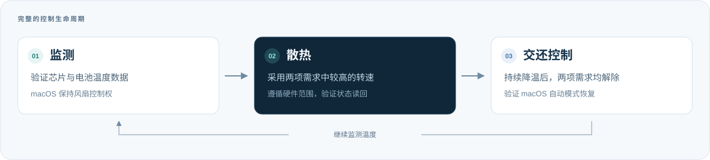
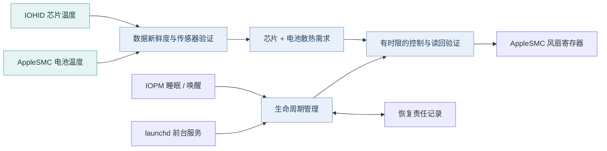

<p align="center">
  <a href="README.md">English</a> · <strong>简体中文</strong>
</p>

<p align="center">
  
</p>

<p align="center">
  <strong>轻量、本地运行的风扇控制工具，支持自动温控。</strong><br>
  监测芯片与电池温度，按需散热，降温后交还 macOS 管理。
</p>

<p align="center">
  
</p>

<p align="center">
  <a href="#installation">开始使用</a> ·
  <a href="#cli-usage">命令行</a> ·
  <a href="#automatic-thermal-control">温控策略</a> ·
  <a href="deploy/README.md">系统服务</a> ·
  <a href="docs/ARCHITECTURE.md">架构</a> ·
  <a href="docs/PROVENANCE.md">代码来源</a>
</p>

---

M1FanControl 通过 **IOKit 直接访问 AppleSMC**，并通过 **IOHID** 读取带有名称的芯片温度事件。你可以在 Terminal 中前台运行、启动后台进程，或安装可选的系统级 LaunchDaemon。控制器根据温度需求接管风扇，在满足解除条件后恢复自动模式，并验证 macOS 已重新接管。

适用于配备风扇的 **Apple M1** Mac。无需图形界面、内核扩展或修改 SIP。

## 功能

| 监测 | 控制 | 恢复 |
| --- | --- | --- |
| 实际与目标 RPM、风扇模式、硬件转速范围 | 硬件最高转速模式，或芯片 + 电池自动温控 | 停止或常规故障后恢复自动模式并验证 |
| 实时温度与只读温控预览 | 迟滞、平滑降速、有时限的读回验证 | 恢复责任记录、新鲜传感器数据确认、有界重试 |
| 显式启用的逐操作 SMC trace | 前台运行、脱离终端的后台进程、原生 launchd 服务 | 睡眠通知处理与唤醒后重连 |

<p align="center">
  
</p>

<a id="installation"></a>

## 安装

安装 [Apple 命令行工具](https://developer.apple.com/xcode/resources/)和当前稳定版 [Rust 工具链](https://rustup.rs/)，包含 `rustfmt` 与 `clippy`。项目使用 Rust edition 2024，仅有一个 Cargo 依赖 `libc`，版本由 `Cargo.lock` 锁定。

```sh
git clone https://github.com/TanhJK728/M1FanControl.git
cd M1FanControl
cargo build --locked --release

# 先进行只读检查
./target/release/m1fan status
./target/release/m1fan preview --samples 10
```

直接运行 `target/release` 中的程序即可，无需下载预编译二进制。构建不会安装或启动控制器。支持的硬件范围与验证状态见[兼容性](#compatibility)。

<a id="cli-usage"></a>

## 命令行使用

**只读检查，不接管风扇**

```sh
./target/release/m1fan status
./target/release/m1fan monitor --samples 10
./target/release/m1fan preview --samples 10
./target/release/m1fan verify-auto
```

`monitor` 显示实时读数；`preview` 还会显示温控策略建议的散热需求。省略 `--samples` 时，两者会持续运行直到收到中断。

**前台控制**

```sh
sudo ./target/release/m1fan max   # 硬件报告的最高转速
sudo ./target/release/m1fan run   # 自动温控策略
```

按 Ctrl+C 后，程序请求恢复自动模式并验证结果。

**后台运行**

```sh
sudo ./target/release/m1fan start
sudo ./target/release/m1fan daemon-status
sudo ./target/release/m1fan stop
```

后台进程可在关闭 Terminal 后继续运行。状态输出包含运行时间、温度、RPM、控制权、状态切换、电源事件与错误。没有控制器持有锁时，可使用 `sudo ./target/release/m1fan auto` 显式恢复自动模式。

<details>
<summary><strong>详细诊断</strong></summary>

在数据读取或控制命令后添加 `--trace /path/to/new-trace.jsonl`，即可记录每次 SMC 操作。目标文件必须尚不存在。正常运行不会生成完整的底层通信 trace。trace 包含原始寄存器通信和运行测量数据，分享前请检查内容。

</details>

<a id="automatic-thermal-control"></a>

## 自动温控

控制器分别跟踪芯片与电池的散热需求，采用两者中**较高的目标转速**。

| 温度来源 | 开始散热 | 请求最高转速 | 解除散热需求 |
| --- | --- | --- | --- |
| 通过验证的芯片传感器中的最高温度 | **55°C** | **70°C** | 持续 30 秒低于 50°C |
| 通过验证的电池传感器中的最高温度 | **35°C** | **40°C** | 持续 30 秒低于 35°C |

散热需求激活后，比例随温度线性地从 25% 增至 100%，并映射到硬件报告的最低与最高转速之间：

```text
目标转速 = 最低转速 + 比例 ×（最高转速 − 最低转速）
```

两项需求都解除后，控制器才恢复 macOS 自动管理。交还控制权后继续监测。接通电源与使用电池时采用相同策略。

温度上升时及时提高目标转速；降低目标前需要确认，并按照经过的时间平滑降速，使用死区忽略微小变化。温度数据无效、不完整、过期或连续不可用时，会触发恢复流程并重新验证传感器。

这些阈值可在源码中调整，默认策略倾向于提前散热并接受更明显的风扇声音。它们属于工程设定，不代表 Apple 的温度上限，也不构成电池寿命保证。电池键 `TB1T`、`TB2T` 沿用 Stats 的映射，具体物理位置仍未确认。本工具不管理充电或充电上限。

## 后台服务与睡眠 / 唤醒

可选的系统级 LaunchDaemon **直接管理前台运行的 `m1fan serve`**，运行不依赖 Terminal 或源码目录。

先以普通用户身份构建并测试，再安装已经检查的二进制：

```sh
cargo test --locked
binary_sha=$(shasum -a 256 target/release/m1fan | awk '{print $1}')
sudo ./deploy/install.sh "$PWD/target/release/m1fan" "$binary_sha"
sudo "/Library/Application Support/M1FanControl/enable.sh"
sudo "/Library/Application Support/M1FanControl/status.sh"
```

安装后服务初始为**停用状态**。启用操作会注册开机启动并开始监测。本地 SHA-256 用于确保安装的是你检查过的二进制，不提供外部发行签名验证。

| 操作 | 命令 |
| --- | --- |
| 禁用开机启动、停止服务并验证自动模式恢复 | `sudo "/Library/Application Support/M1FanControl/disable.sh"` |
| 停止服务、恢复自动模式并移除受管理的安装文件 | `sudo "/Library/Application Support/M1FanControl/uninstall.sh"` |

`m1fan stop` 停止当前实例，保留开机启用状态。需要持续停用时使用 `disable.sh`。运行日志会轮换；卸载后保留私有管理历史。

睡眠通知会暂停控制操作，并在有时限的通知确认窗口内请求恢复自动模式。唤醒或监测间隔超过 5 秒后，控制器重建连接、确认自动模式，并要求连续三次新鲜且健康的采样。恢复重试间隔为 **5 → 15 → 30 → 60 秒**，之后保持每 60 秒重试。

常规错误和 SIGINT / SIGTERM / SIGHUP 会尝试恢复自动模式并验证结果。SIGKILL、断电与内核故障无法执行清理。运行状态仍保留时，恢复责任记录让后续进程继续承担尚未完成的恢复责任；`/var/run` 状态通常会在重启时清除。管理与升级详情见[服务指南](deploy/README.md)（英文）。

## 软件架构



传输层仅允许写入经过验证的风扇控制键，并在控制路径中读取硬件转速上下限。独占控制锁防止多个 M1FanControl 实例同时写入。写入应答、模式与目标读回、后续控制权丢失、实际 RPM 响应分别检查。

进一步阅读[完整架构](docs/ARCHITECTURE.md)、[开发历史](docs/DEVELOPMENT_HISTORY.md)和[代码来源](docs/PROVENANCE.md)（英文）。

<a id="compatibility"></a>

## 支持的硬件与兼容性

风扇控制要求 **Apple M1、ARM64 macOS**、实体风扇，以及预期的 SMC / IOHID 接口。自动温控还要求完整的命名芯片传感器组和两个电池温度键。软件的风扇发现与控制支持多个风扇；真实硬件验证覆盖单风扇 M1 MacBook Pro 配置。

| 验证范围 | 状态 |
| --- | --- |
| 手动与温度触发加速、后台运行、停止与恢复、服务管理 | 已在开发用 M1 硬件上验证 |
| 睡眠事件、唤醒重连、传感器故障与恢复状态机 | 已实现，并由 Mock 测试覆盖 |
| 真实合盖睡眠 / 唤醒、登录前启动、自然降温满足两项解除条件、主动制造崩溃后的重启恢复 | 尚待端到端硬件验证 |

M1 Pro / Max / Ultra、更新的芯片、Intel Mac 和无风扇 Mac 不在支持的控制范围内。Apple 私有接口可能随 macOS 版本变化。不支持的数据会被拒绝，程序不会使用猜测的键或转速限制。请勿同时运行其他风扇控制器。

## 开发与测试

```sh
cargo fmt --check
cargo clippy --locked -- -D warnings
cargo test --locked
cargo build --locked --release
```

v0.5.0 源码发行版通过了 **250 项测试**，另有一项被动原生电源测试默认忽略。已记录的验证范围见[发行审查](docs/RELEASE_AUDIT.md)（英文）。

默认测试使用合成硬件读数、确定性时钟、临时文件与注入的部署命令，不会接管风扇、安装服务或触发真实睡眠。部署测试包含 shell / plist 检查，需要 macOS 工具。真实硬件验证需单独、明确执行。

## 参考项目与致谢

M1FanControl 基于以下项目的技术工作继续开发：

- **[Ramin Sharifi 的 MacFanControl](https://github.com/raminsharifi/MacFanControl)** — 改编了其 Rust AppleSMC 传输实现、风扇控制流程与温度发现模式。
- **[Serhiy Mytrovtsiy 的 Stats](https://github.com/exelban/stats)** — 参考并沿用了相关控制 / 释放流程、IOHID 采集与传感器映射，也参考了其生命周期设计。
- **[Alexander Goodkind 的 macos-smc-fan](https://github.com/agoodkind/macos-smc-fan)** — 参考其对 Apple Silicon 风扇控制权仲裁与系统覆盖目标值的研究。
- **Chromium 与 Apple 接口源码** — 参考传感器命名、ABI、事件时钟和电源通知语义。

[代码来源审查](docs/PROVENANCE.md)记录了固定参考版本、改编区域与独立贡献，也包括 IOHID 读取实现的更早来源。适用的版权声明与完整许可证文本保留在[第三方声明](THIRD_PARTY_NOTICES.md)及 [`licenses/`](licenses/) 中。

## 独立贡献

本项目独立完成的主要工程工作包括：

- **可观测的控制流程：** 分阶段读回验证、控制权丢失诊断、类型化写入限制，以及在可能改变硬件状态的操作前建立恢复责任。
- **温度驱动的调速：** 独立的芯片 / 电池需求、传感器数据新鲜度与集合检查、平滑降速、实际 RPM 响应监测。
- **受管理的恢复流程：** 唤醒 / 重启后有时限的恢复前检查、跨进程实例保留恢复责任、受保护的 IPC，以及经过验证的服务移除事务。
- **可测试的硬件接口：** 可注入的 SMC、传感器、时钟与电源接口，配合确定性的故障场景。

SMC 传输层和部分采集代码属于改编实现。[逐模块评估](docs/PROVENANCE.md#module-level-assessment)说明了各部分的来源分类，以及与参考项目的具体差异。

## 许可证

采用 **[MIT 许可证](LICENSE)**，适用的第三方版权与许可条款保留在 [THIRD_PARTY_NOTICES.md](THIRD_PARTY_NOTICES.md)。原创视觉素材使用项目许可证。macOS 框架与开发工具由各自提供方单独提供。
