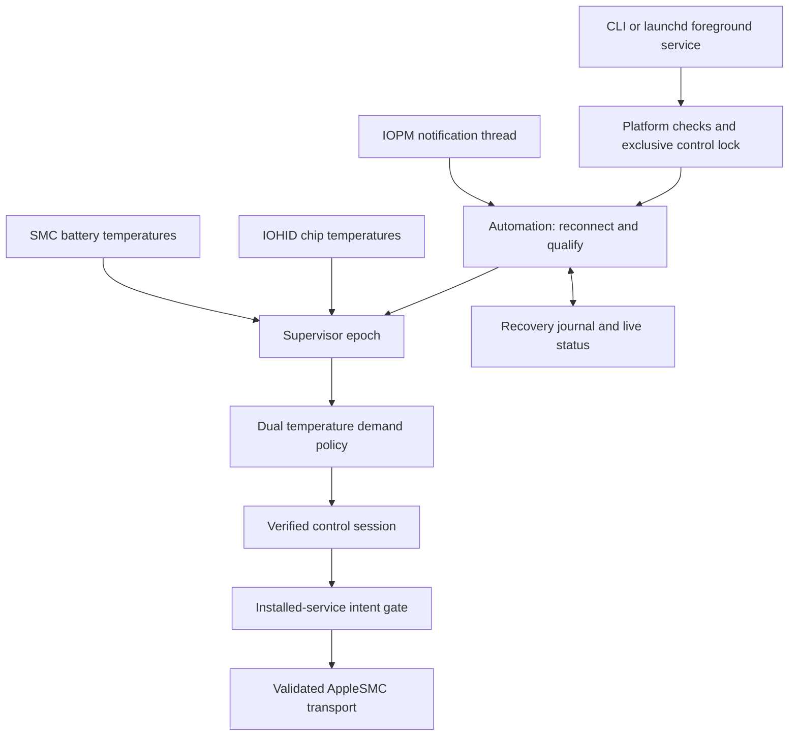

# Architecture

M1FanControl is a Rust command-line controller with direct user-space access to AppleSMC and IOHID. The current write path requires an ARM64 Mac whose reported chip name is exactly `Apple M1`. Fan discovery, metadata validation and sensor qualification determine whether a control session can proceed. Other Apple Silicon generations are not enabled by this check.

## Components

| Component | Responsibility |
| --- | --- |
| `smc.rs` | AppleSMC IOKit transport, C ABI layout, value codecs, response validation and the production write allowlist |
| `fan.rs` | Fan discovery, confirmed mode keys, dynamic RPM limits and state snapshots |
| `control.rs` | Bounded mode/target observations, ownership-loss detection, dynamic target changes and automatic-mode restoration |
| `temps.rs` | SMC temperature-key discovery for general CLI telemetry |
| `chip_temps.rs` | IOHID chip-temperature selection, timestamp validation, sensor-set validation and reconnection |
| `battery.rs` | Battery-temperature readings from the reference-mapped SMC keys `TB1T` and `TB2T` |
| `demand.rs` | Current chip/battery demand policy, hysteresis, cooling confirmation and RPM smoothing |
| `thermal.rs`, `adaptive.rs` | Earlier chip-only policy and orchestration retained as tested library components; `thermal.rs` also provides the current RPM watchdog |
| `supervisor.rs` | One monitoring/control epoch, with a recovery-guarded session and explicit lifecycle hooks |
| `automation.rs` | Sensor qualification, reconnect epochs, bounded retry delays, power-event handling and live status |
| `power.rs` | Native IOPM notifications and a dedicated Core Foundation run loop |
| `service_state.rs`, `service_smc.rs` | Durable recovery responsibility, crash retry state and the installed-service write gate |
| `daemon.rs` | Detached manual workers, foreground-service IPC, startup handshake and bounded runtime logs |
| `platform.rs`, `main.rs`, `trace.rs` | Platform checks, control lock, signals, commands, observers and opt-in diagnostics |
| `deploy/` | Verified installation, launchd management, readiness checks and removal after recovery |

## Transport and control contract

The AppleSMC connection uses IOKit struct-method selector `2` and the 80-byte request/response layout described in [PROVENANCE.md](PROVENANCE.md). Commands `9`, `5`, `6` and `8` read key metadata, read values, write values and enumerate key indices respectively. Transport errors, SMC firmware result codes and response lengths are checked separately. Floating-point RPM values use little-endian `flt `; `fpe2` uses its big-endian fixed-point representation.

Read-only operations use the `ReadSmc` capability. Control additionally requires `WriteSmc`. The native backend limits writes to discovered fan mode/target keys and an optional metadata-validated `Ftst` key. It validates target types and current hardware limits. There is no arbitrary-key write command, firmware modification or SIP configuration step.

The controller separates write acknowledgment from observed state. Mode and target each have a bounded observation window: up to two seconds, observations at approximately 100 ms intervals, and three consecutive matching observations. A target match allows the representation tolerance of 0.25 RPM. Once the expected state has been observed, its loss is reported distinctly. Target updates do not continuously rewrite the mode to contest another controller.

Recovery responsibility is established before a possible write. Normal return, errors and unwind cleanup attempt automatic restoration. Recovery visits all relevant fans, releases a validated `Ftst` when applicable, and verifies automatic modes with repeated reads. A changing target or actual RPM is compatible with automatic mode. Process termination that prevents cleanup, such as `SIGKILL` or power loss, is handled by the next managed instance's recovery journal when that runtime state remains available.

## Temperature demand

The automatic controller uses the highest accepted chip temperature and the higher of the two required battery readings. IOHID product names are matched against explicit supported chip groups. Missing groups, changed sensor sets, non-finite or implausible readings, repeated timestamps, and stale events prevent healthy qualification. These checks validate the exposed events; they do not measure a sensor's internal sampling circuitry.

| Source | Activate | Full-speed request | Release its demand |
| --- | --- | --- | --- |
| Chip | At least 55°C | At least 70°C | Below 50°C for 30 continuous seconds |
| Battery | At least 35°C | At least 40°C | Below 35°C for 30 continuous seconds |

Each active source maps linearly from 25% to 100% of the hardware-reported RPM span. The controller takes the larger demand. Both demands must clear before it releases the fan to macOS and continues monitoring. The policy is identical on AC and battery power. These are cooling-policy defaults, not Apple safety limits, battery-lifetime guarantees or charging controls.

Upward adjustments are responsive; the full-speed endpoint remains reachable. Lower requests require ten seconds of continuous cooling and decrease by at most 5% of the hardware RPM span per second. A 100 RPM deadband combines small writes. Missing telemetry resets cooling confirmation. A rolling 30-second watchdog compares actual RPM with 80% of the lowest target held in that interval, allowing time for acceleration while detecting persistent inadequate response.

## Service lifecycle

The `serve` command remains in the foreground for launchd. `start` creates a detached manual worker with a parent/child readiness handshake. Both paths use the same control lock and temperature supervisor. IPC uses a private Unix socket with peer-UID checks, bounded messages and bounded client waits; process IDs are diagnostic information, not the authority used to stop a controller.

The system LaunchDaemon starts an installed binary at `/Library/Application Support/M1FanControl/m1fan`. It uses `RunAtLoad`, restarts unsuccessful exits, and sets a 60-second launchd throttle. The application also retains retry state with delays of 5, 15, 30 and 60 seconds, then 60 seconds thereafter. Application and launchd delays both apply. Healthy operation clears retry escalation after the applicable confirmation period.

Before taking control, an epoch verifies automatic mode and obtains three consecutive healthy snapshots within a ten-second qualification window. A new sensor period separates qualification from control. Control faults end the epoch, attempt recovery, and enter bounded backoff. Read-only initialization failures do not authorize overriding another application's manual fan control.

The private restart journal records `control_pending` before control writes. It clears this responsibility only after automatic ownership is verified. The installed `service.enabled` marker is checked during the loop and before normal transport writes. A disabled or unreadable marker still permits validated automatic-release operations. This prevents a delayed restart from acquiring control during disable or uninstall.

## Sleep, wake and scheduling gaps

An independent notification thread receives IOPM events. `CanSystemSleep` is acknowledged immediately. `SystemWillSleep` closes the control gate and advances a generation counter, causing the active epoch to exit and recover. The controller then acknowledges sleep. A separate three-second acknowledgment deadline lets macOS sleep even if a hardware call is delayed; acknowledgment alone is not evidence of fan restoration.

`SystemWillPowerOn` keeps control gated. Full wake or cancelled sleep opens a new epoch, rebuilds SMC/HID connections, confirms fan identity and qualifies fresh temperature data. A sampling or I/O gap exceeding five seconds follows the same recovery and reconnection path. The exclusive control lock remains held across epochs. Old connections and sessions finish their recovery path before new ones can take control.

These lifecycle decisions have Mock coverage. Native notification registration and cleanup have been checked separately. End-to-end physical lid sleep/wake, startup before login and release after a naturally observed cool-down still require hardware-specific validation.

## Status, logging and tests

Live status includes phase, uptime, chip/battery temperature, fan mode/target/actual RPM, sample age, last takeover/release/power event, retry state, recovery responsibility and errors. Normal runtime logging records transitions plus periodic summaries. Two runtime log files are bounded to approximately 2 MiB each. Deployment transaction records and archived receipts are retained separately and are not part of that rotation policy.

Full per-operation SMC JSONL output is enabled only by `--trace <new-file>`. Trace files are created privately and refuse existing paths. A logging failure cannot suppress an automatic-restoration write. Trace output may contain system or sensor details; review it before sharing.

Mock interfaces cover the transport, chip source, time, power events and observers. Normal `cargo test` uses mocks, temporary files, temporary IPC and short-lived test processes. Deployment tests inject a fake launchctl runner. The native IOPM registration test is ignored by default. See [the deployment guide](../deploy/README.md) and [provenance audit](PROVENANCE.md) for operational and source details.
